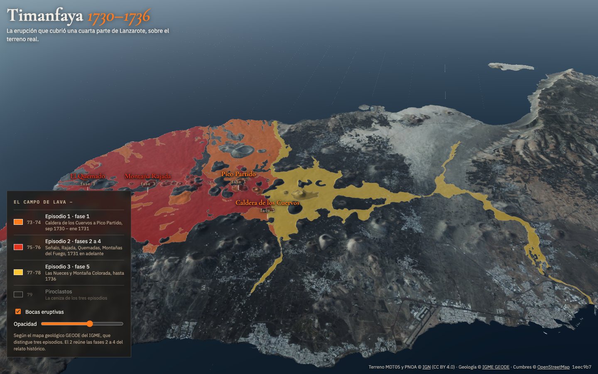
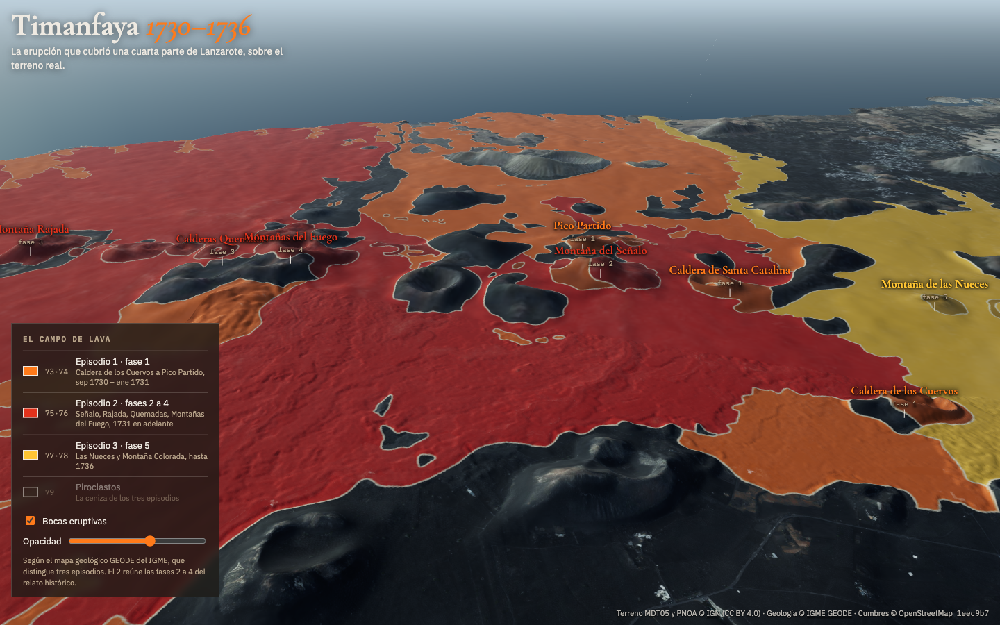

# Timanfaya 1730

[](https://github.com/iloire/timanfaya-1730/actions/workflows/ci.yml)

The 1730–1736 eruption of Timanfaya, shown on the real terrain of Lanzarote, in the browser. It is
being made for the Cabildo de Lanzarote, as a link to share and as a short film. It will roll the
island back to before the eruption, open the vents one by one and let the lava bury the villages
and reach the sea. For now it shows the finished lava field: the three episodes the geological map
tells apart, the vents of each phase, and the island around them, at 5 m.

A spinoff of [driving-sim](https://github.com/iloire/driving-sim) (and through it
[paragliding-sim](https://github.com/iloire/paragliding-sim)): the same terrain engine, without the
car. The plan and its milestones are in [docs/plan.md](docs/plan.md).





## Run it

```bash
npm install
npm run dev        # http://localhost:5173
```

Drag to pan, right-drag to turn, scroll to zoom. The key (bottom left) turns each episode and
the ash on and off.

## Check it

```bash
npm test           # unit tests (Vitest), including the real lava field's area
npm run lint
npm run build      # typecheck + production build
```

CI runs the same three on every push to `main` and every pull request.

## Deploy

Not yet. The repo is private, and GitHub Pages needs a public repo on this plan. The build is a
static site (`dist/`, ~100 MB with the terrain), so any static host will do once it's decided.

## Data

| What | Source | Licence |
|---|---|---|
| Terrain 5 m, orthophoto | IGN MDT05 and PNOA | CC BY 4.0 |
| The lava field, by episode | IGME, GEODE geological map 1:50,000, zone Z2910 | IGME generic: reuse with attribution |
| Vents by phase | Muller & Longpré 2024, after Carracedo et al. 1992; summits from OpenStreetMap | facts / ODbL |

Regenerate the generated data (both write to `public/sites/lanzarote/`):

```bash
npm run fetch-lava       # IGME GEODE → lava.json
npm run fetch-terrain    # IGN → height.bin, ortho.jpg, detail/ (only near the lava)
```

Hand-kept data lives in `public/data/`; its schema is in [public/data/README.md](public/data/README.md).
How it fits together: [docs/architecture.md](docs/architecture.md).
